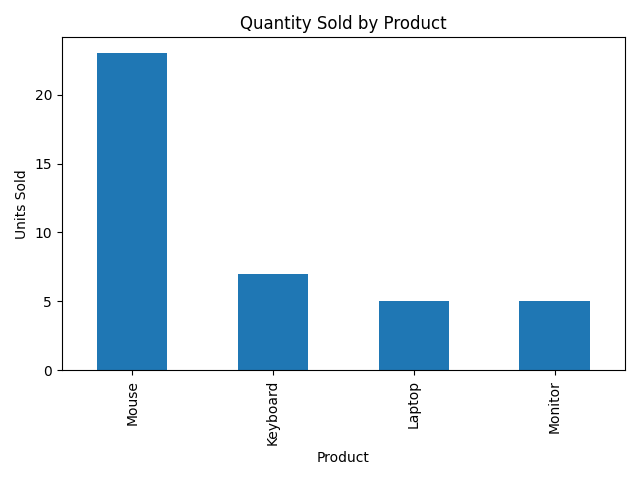
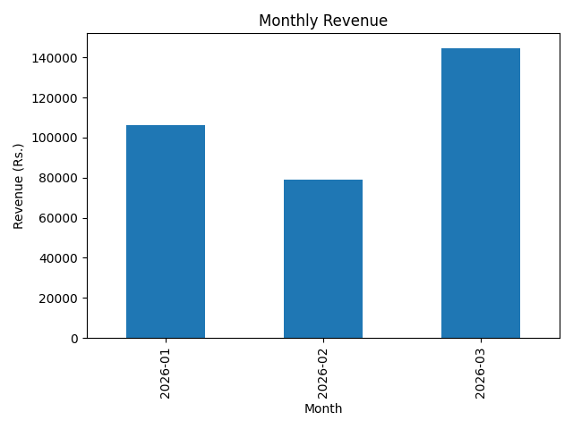
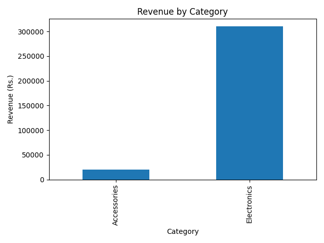

# Sales Data Analysis Using Python

## Project Overview
This project analyzes sample sales data using Python to identify revenue trends, product performance, and category-level sales. It demonstrates fundamental data analysis skills through data processing, calculations, visualization, and business recommendations.

## Objectives
- Calculate total revenue and average order value.
- Identify best-selling products by quantity.
- Find products generating the highest revenue.
- Analyze monthly revenue trends.
- Compare revenue across product categories.
- Provide data-driven business recommendations.

## Tools and Technologies
- Python
- Pandas
- Matplotlib
- CSV
- Visual Studio Code
- GitHub

## Project Structure
- `sales.csv` — Sample sales dataset.
- `sales_analysis.py` — Python analysis script.
- `product_sales.png` — Product quantity chart.
- `monthly_revenue.png` — Monthly revenue chart.
- `category_revenue.png` — Category revenue chart.
- `insights.md` — Business insights and recommendations.
- `README.md` — Project documentation.

## Key Performance Indicators
The Python script calculates:
- Total revenue
- Total units sold
- Number of unique orders
- Average order value
- Revenue by product
- Revenue by month
- Revenue by category

## Visualizations

### Product Sales

### Monthly Revenue

### Category Revenue

## How to Run the Project

1. Install Python.
2. Install the required libraries:

   `python -m pip install pandas matplotlib`

3. Run the analysis:

   `python sales_analysis.py`

4. Review the terminal results, generated charts, and `insights.md`.

## Business Insights
The script identifies the highest-selling product by quantity, the product generating the highest revenue, the best month by revenue, and the highest-revenue category.

See `insights.md` for the calculated findings and recommendations.

## Dataset Limitations
This project uses a small sample dataset covering three months. Revenue does not represent profit because product costs and operating expenses are not included. Results are illustrative and should not be treated as long-term business trends.

## Author
Naveen A

## Project Repository
https://github.com/naveenayoor2005/Sales-Data-Analysis
